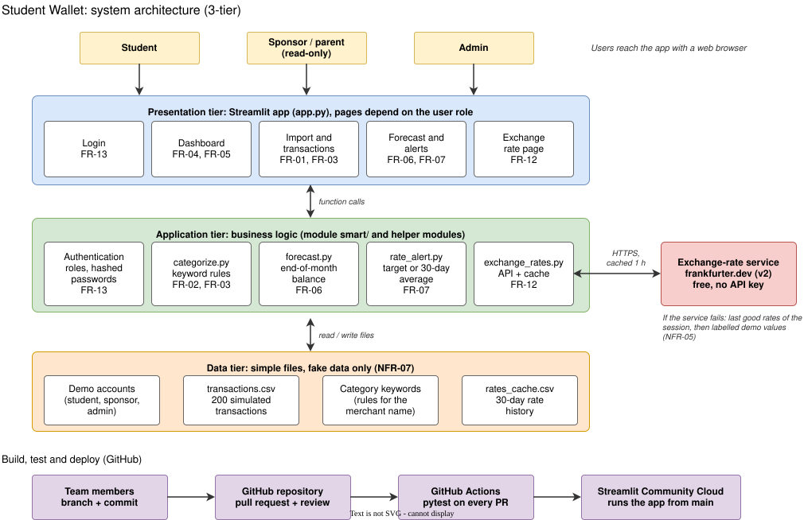

# Design

Design artefacts of the Student Wallet. Diagrams are made in draw.io and wireframes in Figma.

## Architecture

The app has three tiers, as in the lesson on design tools (UI, application, database):

- Presentation tier: the Streamlit pages in `app.py`. Which pages a user sees depends on the role (student, sponsor, admin).
- Application tier: the business logic. The smart features are in the `smart/` module (`categorize.py`, `forecast.py`, `rate_alert.py`), next to authentication and `exchange_rates.py`.
- Data tier: simple files with fake data (transactions, demo accounts, category keywords, rate history). No real bank data is used.

The only external system is the exchange-rate service frankfurter.dev. If it is down, the app uses the last good rates, then labelled demo values.

Each box shows the functional requirements it covers (see `02-Requirements/requirements.md`). Tests run on every pull request in GitHub Actions, and `main` is deployed to Streamlit Community Cloud.

To edit the diagram, open `architecture.drawio.svg` in draw.io (app.diagrams.net) and save it again with the same name.

## Wireframes

Low-fidelity screens made in Figma (issue #6).

- `wireframes/dashboard.png`: balance in MYR and home currency, spending by category, end-of-month forecast, rate alert
- `wireframes/import.png`: CSV upload, preview and category check before importing
- `wireframes/forecast-alerts.png`: balance forecast, alerts and alert settings

Figma file: https://www.figma.com/design/OUeFouFwRPYrfb4Jaok4kV/Student-Wallet

## Slide template

[Student Wallet – Google Slides](https://docs.google.com/presentation/d/1ckQbXZcwGGD7Ia6V4as7VqPV_wuQxb1vSON3BfPTkTI/edit?usp=sharing)
